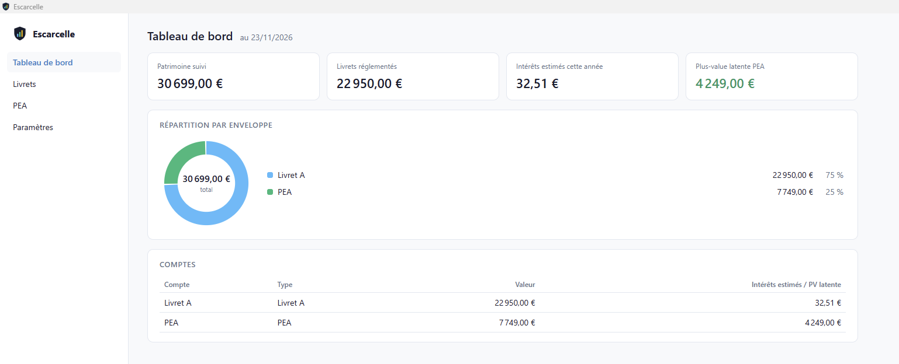
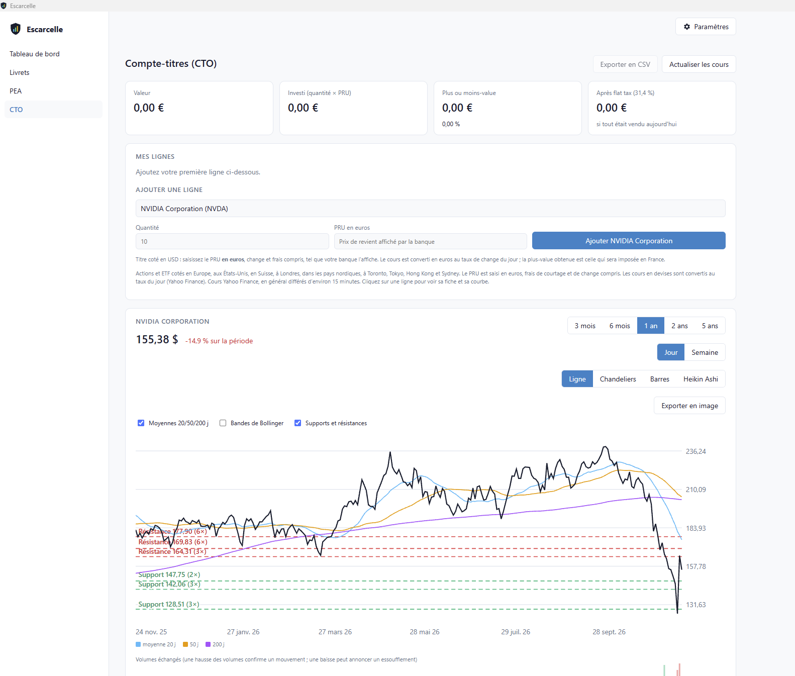

<p align="center">
  
</p>

<h1 align="center">Escarcelle</h1>

<p align="center">
  <strong>Logiciel libre, gratuit et local pour suivre ses livrets réglementés, son PEA et son compte-titres.</strong><br>
  Vos données restent sur votre ordinateur : pas de compte, pas de serveur, pas de connexion à votre banque.
</p>

> Version 0.2 en test.

## Ce que fait Escarcelle

- **Livrets réglementés** (Livret A, LDDS, LEP) : virements, soldes, plafonds, intérêts calculés par quinzaines, et conseils pour verser et retirer au bon moment, avec une frise colorée.
- **PEA et compte-titres (CTO)** : recherche d'actions et d'ETF européens et, dans le CTO, américains, suisses, britanniques… avec conversion en euros, saisie des lignes (quantité, PRU), cours automatiques, plus ou moins-values, et sur le CTO, plus-value après flat tax.
- **Dividendes** : dividende annuel, rendement, croissance, prochain détachement estimé, et dividende net après retenue à la source du pays, flat tax et crédit d'impôt selon l'enveloppe.
- **Courbes et analyse technique** : ligne, chandeliers japonais, barres, Heikin Ashi, en journalier ou hebdomadaire ; volumes, moyennes mobiles, Bollinger, RSI, MACD, supports et résistances ; signaux expliqués en clair (cassures, figures, motifs de chandeliers, structure de tendance, confirmation hebdomadaire).
- **Alertes** : détachements de dividendes et assemblées générales des 45 prochains jours.
- **Tableau de bord** avec répartition de l'épargne et dividendes nets annuels.
- **Exports** en CSV (Excel) et en image PNG.
- **Sauvegarde, restauration**, effacement des données, et avis de nouvelle version au démarrage.

## Captures d'écran

### Tableau de bord


### Livrets réglementés


### PEA


### Compte-titres : actions en devises


### Analyse technique


## Documentation

- [Guide d'utilisation](docs/GUIDE.md)
- [Spécification](docs/SPEC.md)
- [Compiler et lancer](docs/COMPILER.md)

## Structure

```
crates/escarcelle-core    Calculs (livrets, analyse technique, dividendes, fiscalité PEA/CTO…), sans dépendance
crates/escarcelle-quotes  Chaîne de sources de cours
app/                   Application de bureau : Tauri v2 (Rust) + Svelte, stockage SQLite
catalogue/             Frais et conditions des établissements (versions suivantes)
docs/                  Documentation
```

## Développement

```sh
cargo test                 # cœur de calcul : 76 tests, sans réseau
cd app && npm install && npm run tauri dev
```

Principes : montants en centimes, aucun flottant pour l'argent, chaque règle couverte par un test.

## Avertissement

Escarcelle fournit des simulations à titre informatif. Il ne remplace ni un conseiller en investissements financiers (CIF) ni l'administration fiscale. L'analyse technique décrit le passé et ne constitue pas un conseil d'achat ou de vente.

## Licence

Copyright © 2026 ChatCarbo

Escarcelle est un logiciel libre distribué sous licence [GNU GPL v3.0 ou ultérieure](LICENSE). Vous pouvez l'utiliser, l'étudier, le modifier et le redistribuer. Toute version modifiée que vous distribuez doit rester sous la même licence, avec son code source.

Les cours de bourse affichés proviennent de Yahoo Finance et ne sont pas couverts par cette licence.
